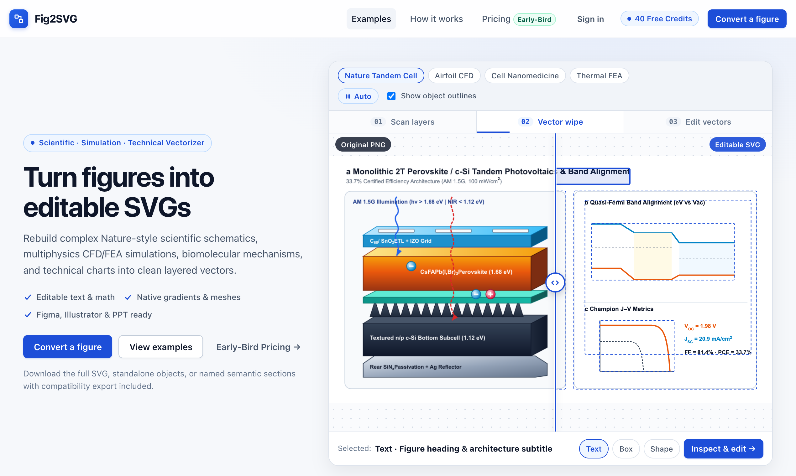
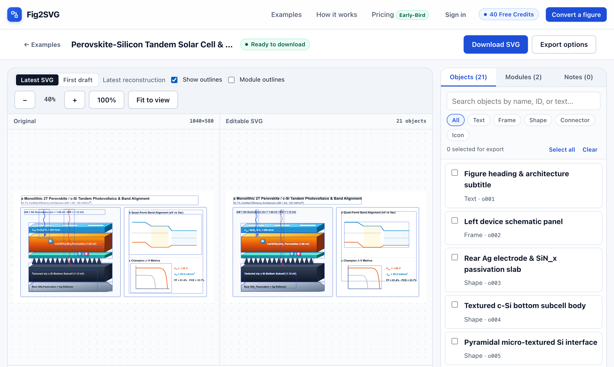
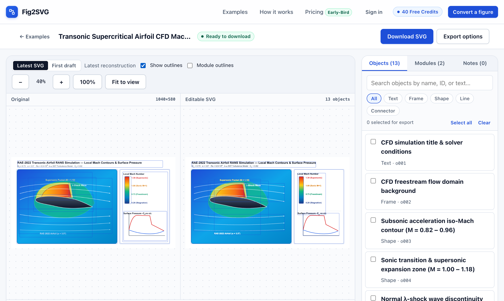

# Editable Scientific & Technical SVG Examples (`fig2svg-examples`)

A curated open collection of layered, editable SVG reconstructions converted from flat raster scientific schematics, CFD contour plots, and technical diagrams — built with [Fig2SVG](https://fig2svg.online/).

Unlike classic bitmap auto-tracers that outline glyphs into uneditable polygons, every SVG in [`examples/`](examples/) keeps:

- **Native editable `<text>` & `<tspan>` labels** (including subscripts, superscripts, and physical units)
- **Clean semantic grouping** (`id`, `data-role`, reusable multi-part modules)
- **Smooth `<linearGradient>` / `<radialGradient>` fills** instead of posterized trace patches
- **Compatible connectors & arrowheads** ready for Adobe Illustrator, Figma, Inkscape, and Microsoft PowerPoint

---

## Visual Before & After Previews

| Nature-Style Perovskite-Silicon Tandem Schematic | Transonic Airfoil CFD Contour Plot |
| :---: | :---: |
|  |  |

---

## Included Open Editable SVG Files

| Showcase File | Domain | Highlights | Inspect Online |
| :--- | :--- | :--- | :--- |
| [`examples/perovskite-tandem-solar-cell.svg`](examples/perovskite-tandem-solar-cell.svg) | Scientific schematic | Layered device cross-section, band alignment, editable chemical/energy labels | [Interactive Comparison](https://fig2svg.online/examples/sci_nature_perovskite_tandem_20261119) |
| [`examples/transonic-airfoil-cfd.svg`](examples/transonic-airfoil-cfd.svg) | Simulation & CAE | Transonic airfoil CFD Mach contours, smooth colorbar gradient, crisp streamlines | [Interactive Comparison](https://fig2svg.online/examples/sim_cfd_airfoil_transonic_20261119) |
| [`examples/approval-workflow-diagram.svg`](examples/approval-workflow-diagram.svg) | Architecture & flowchart | Clean swimlane cards, routed connectors, editable status labels | [Interactive Comparison](https://fig2svg.online/examples/nonsci_approval_workflow_20261118) |

---

## Quick Technical Guides

- **[Why PowerPoint Drops SVG Arrowheads & Shifts Text Baselines (and How to Fix It)](guides/powerpoint-svg-compatibility.md)** — a practical reference for anyone importing technical SVGs into Office or Figma.
- **[Convert PNG to SVG with Editable Text](https://fig2svg.online/png-to-svg-editable-text)** — preserving axis labels, formulas, and units during reconstruction.
- **[Scientific & Nature-Style Figure to Editable SVG](https://fig2svg.online/scientific-figure-to-svg)** — workflow for journal paper revisions and CFD/FEA plots.
- **[Fig2SVG vs Vectorizer.ai & Illustrator Image Trace](https://fig2svg.online/vs/vectorizer-ai)** — when to use pixel curve fitting vs semantic vector reconstruction.

---

## Try Your Own Figure

Visit **[fig2svg.online](https://fig2svg.online/)** to inspect 21 live side-by-side reconstructions with zero signup, or create a free account (`40` trial credits included) to convert your own PNG, JPG, WebP, BMP, or TIFF figure.

## License

The example SVGs and documentation in this showcase repository are released under the [MIT License](LICENSE).
